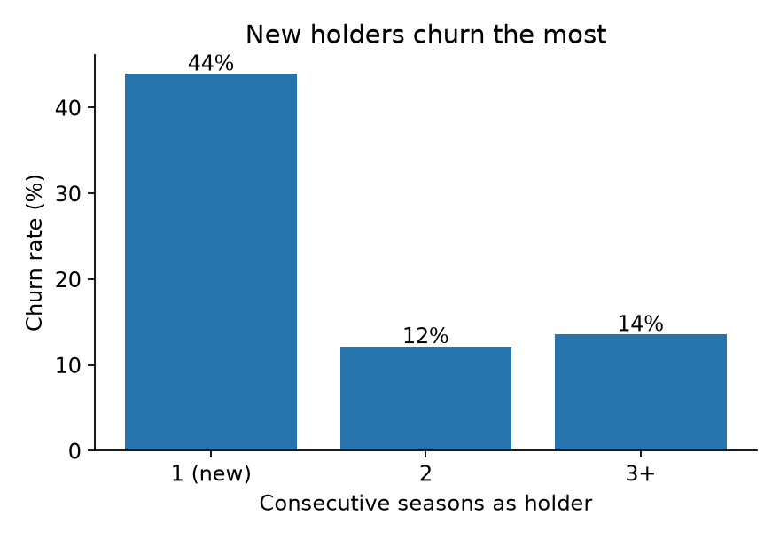
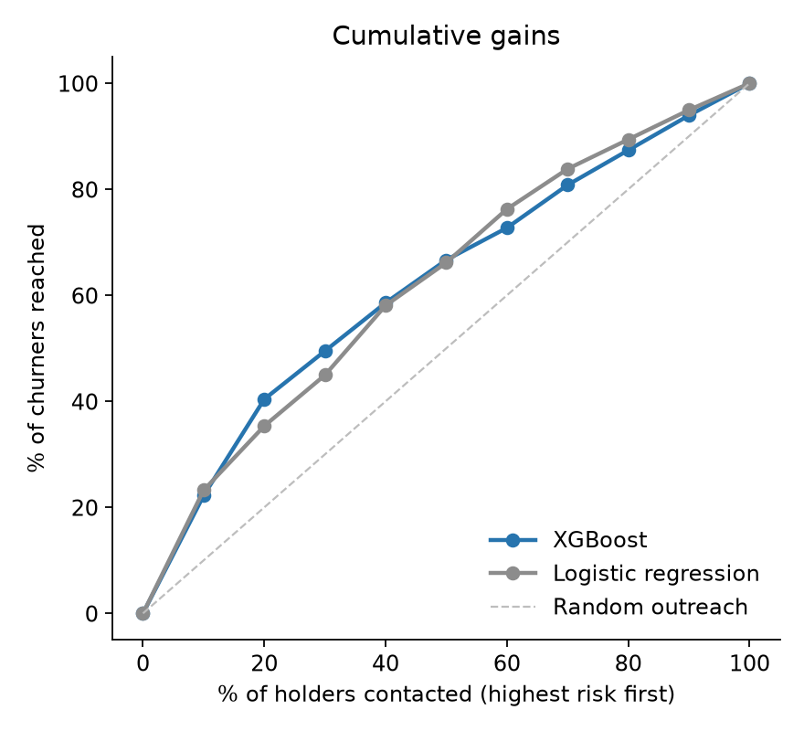
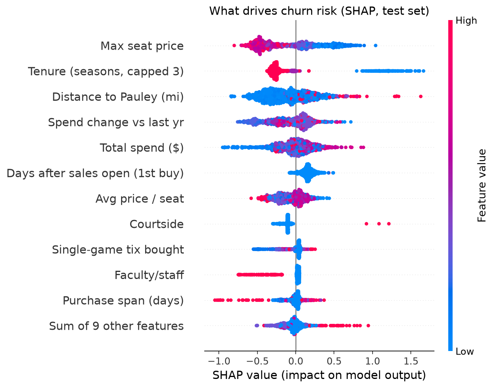

# Predicting Season-Ticket Churn — UCLA Men's Basketball

Which season-ticket holders will **not renew** next year, and who should the ticket office call first?

This project builds a churn model on five seasons (2021-22 to 2025-26) of UCLA Men's Basketball season-ticket purchase records. It tests the model **out of time**: it trains on past renewal decisions and predicts a season the model has never seen.

> **Data note:** the underlying ticketing data belongs to UCLA Athletics and is **not included**. A synthetic data generator with the same schema is provided, so the full pipeline runs end to end (see [Reproduce](#reproduce)). The results below come from the real data.

---

## Key findings

| | |
|---|---|
| Season-ticket holders per season | ~1,100 – 1,700 |
| Annual churn rate | 13 – 19% |
| Revenue from holders who churned after 2024-25 | **$406K** |



- **First-year holders are the biggest risk.** 44% of first-season holders do not renew, compared with 12–14% of holders who have renewed at least once. Getting new holders to their second season matters more than anything else.
- **Seat quality protects retention.** Holders in the lowest seat-price quartile churn at 28%, compared with 10% in the top two quartiles.
- **Distance matters.** Holders billed more than 30 miles from Pauley Pavilion churn at 25%, compared with 14% for local holders.
- **Donors and faculty/staff are stickier.** Holders in donation-required seats churn at 12%, compared with 24% without a donation requirement.

## Model results (out-of-time test: 2024-25 holders → 2025-26 renewal)

| Model | ROC AUC | PR AUC | Churners reached by contacting the top 20% |
|---|---|---|---|
| Logistic regression (baseline) | 0.65 | 0.30 | 35% |
| **XGBoost** | **0.65** | 0.27 | **40%** |
| Random outreach | 0.50 | 0.16 | 20% |

- The **top 10%** of holders by predicted risk churn at **2.2× the average rate** (34% vs. 16%).
- Contacting the **top 20%** reaches **40% of all churners**, about 2× better than random outreach.



### What drives the predictions



Seat price, tenure and distance dominate. Low-price seats, first-year holders and distant holders push risk up. Faculty/staff and long-tenured holders push it down. Buyers who place many separate orders (often a sign of add-on or broker-style buying) also show higher risk.

### Why AUC is ~0.65, not 0.9

The model only sees **purchase transactions**. The strongest real churn signals aren't in this data:

- **Game attendance:** does the holder actually show up?
- **Ticket resale and transfer activity**
- **Email and marketing engagement**
- **Team performance and price changes** relative to the holder's expectations

Logistic regression matches XGBoost, which suggests the signal is mostly simple, roughly additive effects rather than complex interactions. The honest conclusion: purchase data alone gives a **useful prioritization tool** (2× better than random targeting), but adding attendance scans is the obvious next step.

---

## Approach

**Unit of analysis:** one row per (holder, season). **Label:** `churn = 1` if the holder is in season *t* but not in season *t+1*.

**Out-of-time split**

| Split | Seasons | Rows | Churn rate |
|---|---|---|---|
| Train | 2022-23, 2023-24 holders | 2,926 | 16.0% |
| Test | 2024-25 holders | 1,273 | 15.6% |

2021-22 is excluded from training because it is the first season in the data, so tenure and new vs. returning status are unknown (left-censored). XGBoost hyperparameters were chosen with a time-respecting validation step: train on 2022-23, validate on 2023-24.

**Features** (all from season *t* or earlier, so there is no leakage)

| Group | Features |
|---|---|
| Account size | seats, total spend, avg price per seat, max seat price |
| Loyalty | tenure (consecutive seasons, capped at 3), new-holder flag |
| Year-over-year change | seat change, % spend change |
| Seat and price type | donation-required, courtside, Pavilion Club, faculty/staff, ADA, locked-in pricing |
| Purchase behavior | # orders, days after sales open of first purchase, purchase span, comp share |
| Engagement | single-game tickets bought the same season |
| Geography | distance from billing ZIP to Pauley Pavilion (offline `zipcodes` lookup) |

**Business output:** `train.py` also writes a retention priority list, ranked by **expected revenue at risk = P(churn) × current spend**. It stays local and is git-ignored.

## Repo structure

```
├── src/
│   ├── features.py        # raw season files -> one row per holder-season + churn label
│   ├── train.py           # LR + XGBoost, out-of-time eval, SHAP, figures, priority list
│   └── make_synthetic.py  # fake data with the real schema
├── reports/
│   ├── figures/           # charts used in this README (real data)
│   ├── metrics.json
│   └── lift_table_xgb.csv
├── data/                  # git-ignored except synthetic/
└── requirements.txt
```

## Reproduce

```bash
pip install -r requirements.txt

# With synthetic data (anyone)
python src/make_synthetic.py --out data/synthetic
python src/features.py --raw data/synthetic --out data/processed/features_synthetic.csv
python src/train.py --features data/processed/features_synthetic.csv \
    --figs reports/figures_synthetic --metrics reports/metrics_synthetic.json

# With the real files in data/raw/ (season_MBB21.csv ... season_MBB25.csv, mbb_joined_data.csv)
python src/features.py
python src/train.py
```

## Next steps

1. Join **attendance scan data**. No-shows are the classic leading indicator of non-renewal.
2. Add **resale and transfer counts** per holder (StubHub/SeatGeek/ticket transfers).
3. **Survival model** (Cox / discrete-time hazard) to model *when* holders lapse, not just whether.
4. **Uplift model**: once outreach is logged, model who is *persuadable*, not just who is at risk.

---
*Tools: Python, pandas, scikit-learn, XGBoost, SHAP, matplotlib*
